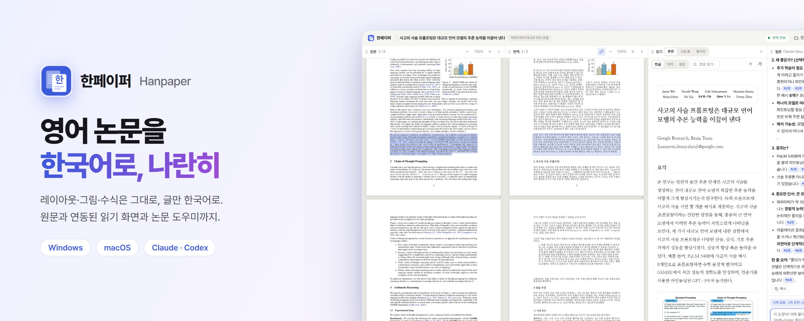
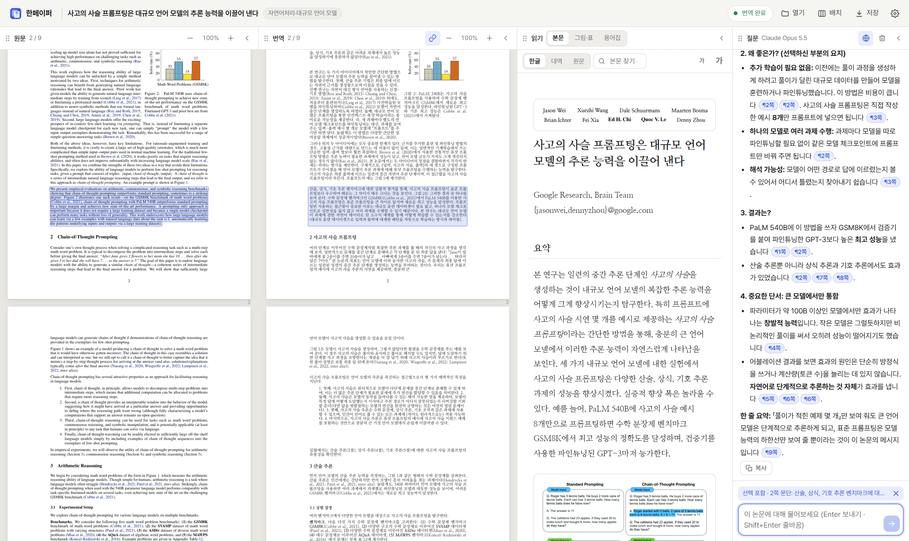
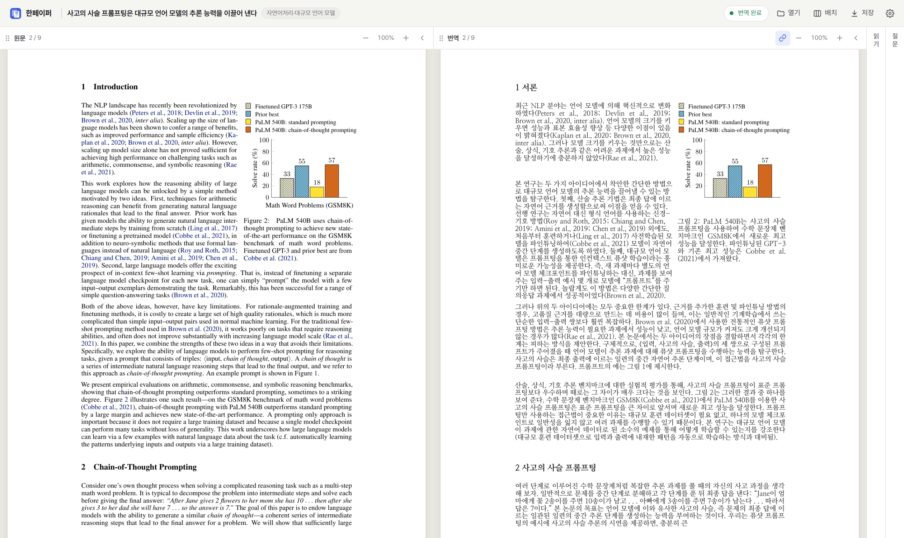
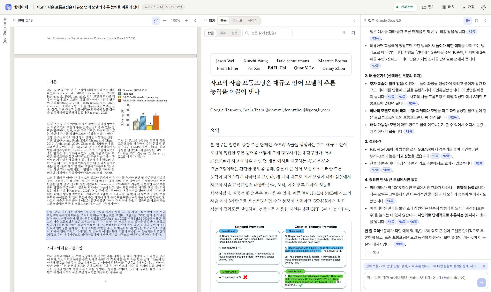
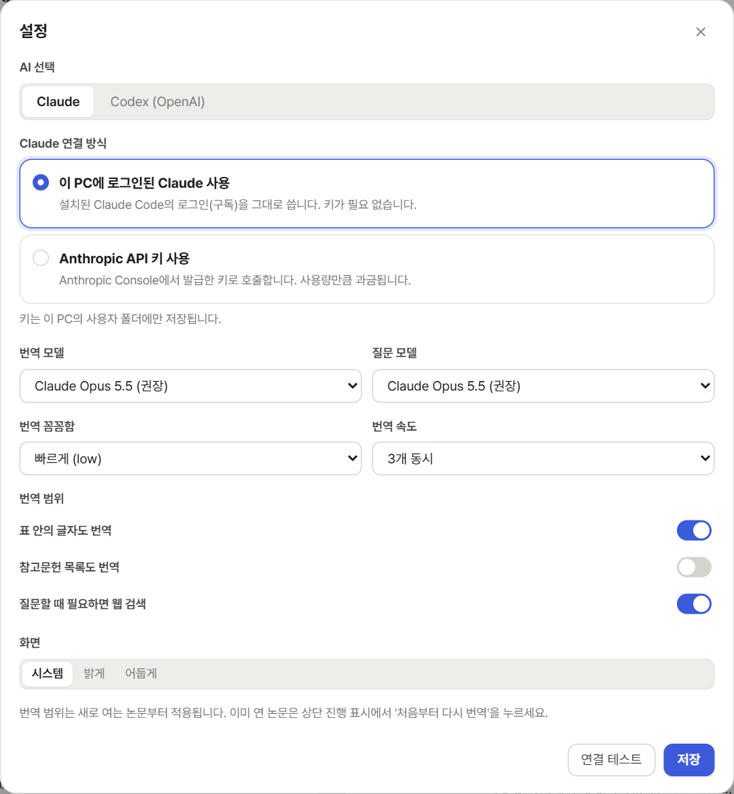

<p align="center">
  
</p>

<p align="center">
  <a href="../../releases/latest"></a>
  <a href="../../releases"></a>
  
  
  <a href="LICENSE"></a>
</p>

<p align="center">
  <a href="../../releases/latest/download/Hanpaper-Setup.exe"></a>
  &nbsp;
  <a href="../../releases/latest/download/Hanpaper.dmg"></a>
</p>

<p align="center">
  <a href="https://mingjaam.github.io/hanpaper/"><b>웹사이트</b></a> &nbsp;·&nbsp;
  <a href="#이런-걸-해요">기능</a> &nbsp;·&nbsp;
  <a href="#설치">설치</a> &nbsp;·&nbsp;
  <a href="#ai-연결">AI 연결</a> &nbsp;·&nbsp;
  <a href="#자주-묻는-질문">FAQ</a>
  <br>
  <sub>설치 없이 쓰려면 <a href="../../releases/latest/download/Hanpaper-windows-x64.zip">Windows 압축 파일</a> · <a href="../../releases/latest/download/Hanpaper-macos.zip">macOS 압축 파일</a></sub>
</p>

<br>

**한페이퍼**는 영어 논문 PDF를 넣으면 **레이아웃·그림·수식·글자 크기는 그대로 둔 한글 논문**을 만들어 주는 데스크톱 앱입니다. 원문과 번역을 양옆에 두고, 읽기 쉬운 본문 화면과 논문 도우미가 서로 연결돼 함께 움직여요.

<p align="center"></p>

## 이런 걸 해요

<table>
  <tr>
    <td width="33%" valign="top">
      <h3>분야 맞춤 번역</h3>
      번역 전에 논문의 분야를 파악하고, <b>한국 학계에서 실제로 쓰는 용어</b>로 용어집을 만들어 따릅니다. 강화학습·합성곱처럼 우리말로 굳은 말은 우리말로, 어텐션·임베딩처럼 음차로 쓰는 말은 음차로.
    </td>
    <td width="33%" valign="top">
      <h3>레이아웃 그대로</h3>
      그림·표·수식·색은 원본 그대로 두고 글만 한국어로 바꿔요. 2단 편집, 그림을 둘러싼 문단, 쪽·단을 넘어가는 문단까지 맞춰 조판해서 원문과 쪽 단위로 1:1로 맞습니다.
    </td>
    <td width="33%" valign="top">
      <h3>모두 연결된 화면</h3>
      읽기 화면에서 문단을 누르거나 드래그하면 <b>원문 PDF와 번역 PDF의 같은 자리</b>가 함께 표시돼요. 두 PDF는 스크롤도 함께 움직입니다.
    </td>
  </tr>
  <tr>
    <td width="33%" valign="top">
      <h3>수식·알고리즘은 원형대로</h3>
      수식과 식 번호, 수도코드(Algorithm 상자), 코드는 번역하지 않고 원래 모습 그대로 둡니다. 읽기 화면에서도 깨지지 않게 이미지로 보여 줘요.
    </td>
    <td width="33%" valign="top">
      <h3>논문 도우미</h3>
      논문 전체를 아는 도우미에게 물어보세요. 답의 근거 문단에 <code>¶3쪽</code> 표시가 붙고, 누르면 그 자리로 이동합니다. 선택한 문단을 두고 물을 수도 있어요.
    </td>
    <td width="33%" valign="top">
      <h3>형광펜과 PDF 저장</h3>
      중요한 문단에 형광펜을 긋고, <b>한글 논문 · 영어 원문 · 원문|번역 대역본</b>을 PDF로 저장합니다.
    </td>
  </tr>
</table>

<table>
  <tr>
    <th width="50%">원문과 한글 논문을 나란히</th>
    <th width="50%">PDF보다 편한 읽기 화면</th>
  </tr>
  <tr>
    <td></td>
    <td></td>
  </tr>
</table>

### 더 있어요

- **화면 배치를 마음대로**: 창 머리의 ⋮⋮를 끌어 순서를, 경계선을 끌어 폭을 바꾸고, 안 쓰는 창은 접어 두세요. 4분할 · 3분할(읽기+질문 위아래) · 원문과 번역만 · 읽기 집중 프리셋이 있습니다.
- **번역은 빠르게, 보이는 건 먼저**: 여러 문단을 동시에 번역하고, 끝난 쪽부터 바로 한글 PDF로 보여 줍니다. 앱을 닫아도 다음에 열면 이어서 번역해요.
- **고치기 쉬운 번역**: 문단마다 '다시 번역'(예: "더 자연스럽게", "agent는 에이전트로")이나 '직접 수정'을 누르면 한글 PDF가 그 자리에서 다시 조판됩니다. 용어집을 고치면 그 용어가 든 문단만 다시 번역해요.
- **번역이 필요 없는 건 그대로**: 그림 속 글자, 저자 이름, 이메일, 참고문헌 목록(설정에서 바꿀 수 있음), 머리글·쪽 번호는 손대지 않습니다.
- **찾기·그림 모아 보기·대역 보기**: 한·영 본문 찾기, 그림·표 갤러리, 한글/대역/원문 보기 전환, 글자 크기 조절, 밝은·어두운 테마.

## 설치

| | 받을 파일 | |
|:---|:---|:---|
| **Windows 10 · 11** | [`Hanpaper-Setup.exe`](../../releases/latest/download/Hanpaper-Setup.exe) | 관리자 권한 없이 설치돼요. 압축 파일은 [`Hanpaper-windows-x64.zip`](../../releases/latest/download/Hanpaper-windows-x64.zip) |
| **macOS 13+** | [`Hanpaper.dmg`](../../releases/latest/download/Hanpaper.dmg) | 앱을 응용 프로그램 폴더로 끌어다 놓으세요. 압축 파일은 [`Hanpaper-macos.zip`](../../releases/latest/download/Hanpaper-macos.zip) |

> macOS에서 "확인되지 않은 개발자" 경고가 뜨면 앱을 **마우스 오른쪽 버튼 › 열기**를 누르거나, **시스템 설정 › 개인정보 보호 및 보안 › 그래도 열기**를 누르세요. (아직 Apple 인증서로 서명하지 않았어요.)

## AI 연결

번역과 질문에는 이미 쓰고 있는 AI를 그대로 씁니다. **설정**에서 AI를 고르면 그 아래에서 연결 방식을 고를 수 있어요.

<p align="center"></p>

| AI | 이 PC에 로그인된 계정 | API 키 |
|:---|:---|:---|
| **Claude** (권장) | [Claude Code](https://claude.com/claude-code)를 설치하고 터미널에서 `claude`로 한 번 로그인하면 그 구독을 그대로 씁니다. | Anthropic Console에서 발급한 키 |
| **Codex** | [Codex CLI](https://github.com/openai/codex)를 설치하고 `codex login`으로 로그인하면 그대로 씁니다. | OpenAI Platform에서 발급한 키 |

- 기본 번역 모델은 Claude Opus 5.5이고, 설정에서 모델·꼼꼼함·동시 작업 수를 바꿀 수 있어요.
- API 키는 내 PC의 사용자 폴더(`%APPDATA%\Hanpaper`, macOS는 `~/Library/Application Support/Hanpaper`)에만 저장됩니다.

## 이렇게 동작해요

1. **분석**: PDF의 글 블록을 읽어 문단·제목·캡션·표 칸·각주를 나누고, 그림(이미지와 벡터 그림 + 그 안의 글자)·표·수식·알고리즘 영역을 먼저 잡습니다. 단·쪽에서 끊긴 문단은 서로 이어 둡니다.
2. **용어집**: 제목·초록·절 제목과 자주 나오는 표현으로 분야를 판단하고, 그 분야 한국어 용어집을 만듭니다.
3. **번역**: 문단 묶음 단위로 앞뒤 문맥·용어집과 함께 번역합니다. 굵게·기울임·아래첨자 같은 글자 꾸밈과 인용 번호, 수식 기호는 그대로 지켜요.
4. **조판**: 원본 쪽에서 번역할 글자만 지우고, 같은 자리에 같은 크기·정렬·들여쓰기·색으로 한글을 앉힙니다. 길어지면 먼저 아래쪽 빈 공간으로 늘리고, 그래도 넘칠 때만 글자를 조금 줄입니다. 그림 옆 문단은 그림을 피해 조판해요.

## 자주 묻는 질문

<details>
<summary><b>비용이 드나요?</b></summary>

앱은 무료입니다. 번역과 질문은 선택한 AI를 쓰므로, 로그인된 Claude Code나 Codex를 쓰면 그 구독 안에서, API 키를 쓰면 사용량만큼 과금됩니다. 10쪽 안팎 논문은 보통 2~3분 걸려요.
</details>

<details>
<summary><b>논문 파일이 외부로 나가나요?</b></summary>

PDF 분석과 조판은 모두 내 PC에서 합니다. 번역할 문단의 글자만 선택한 AI(Anthropic 또는 OpenAI)로 보내요. 번역 결과·형광펜·대화는 내 PC에만 저장됩니다.
</details>

<details>
<summary><b>스캔한 PDF도 되나요?</b></summary>

글자를 선택할 수 있는 PDF(대부분의 학술지·arXiv 논문)를 대상으로 합니다. 이미지로만 된 스캔본은 아직 지원하지 않아요.
</details>

<details>
<summary><b>번역이 이상한 문단이 있어요.</b></summary>

그 문단에서 '다시 번역'(요청 문구를 덧붙일 수 있어요)이나 '직접 수정'을 누르세요. 한글 PDF가 바로 다시 조판됩니다. 레이아웃 분석이 틀린 논문이 있다면 이슈로 알려 주세요.
</details>

## 직접 빌드하기

```bash
git clone https://github.com/Mingjaam/hanpaper && cd hanpaper
python -m venv .venv && .venv/Scripts/pip install -r requirements.txt   # macOS: .venv/bin/pip
python hanpaper/app.py           # 앱 창으로 실행
python hanpaper/server.py        # 브라우저로 실행 (http://127.0.0.1:8790)
```

- Windows 설치 파일: `packaging\build.bat` (PyInstaller + Inno Setup) → `packaging\Output\Hanpaper-Setup.exe`
- macOS 앱: `bash packaging/build_mac.sh` → `dist/Hanpaper.dmg`
- `v*` 태그를 올리면 GitHub Actions가 두 운영체제용 설치 파일을 만들어 Release에 붙이고, `main`에 올리면 웹사이트를 배포합니다.

구성: Python · [PyMuPDF](https://pymupdf.readthedocs.io/)(분석·조판) · [pywebview](https://pywebview.flowrl.com/)(앱 창) · 바닐라 JS 화면.

## 라이선스

[MIT](LICENSE). 함께 들어 있는 글꼴: 나눔명조·나눔고딕(SIL OFL), Noto Sans Math(SIL OFL), Pretendard(SIL OFL).

한페이퍼는 비공식 도구이며 Anthropic·OpenAI와 관련이 없습니다. 화면 속 예시 논문은 Wei et al., *Chain-of-Thought Prompting Elicits Reasoning in Large Language Models* ([arXiv:2201.11903](https://arxiv.org/abs/2201.11903), CC BY 4.0)입니다.
